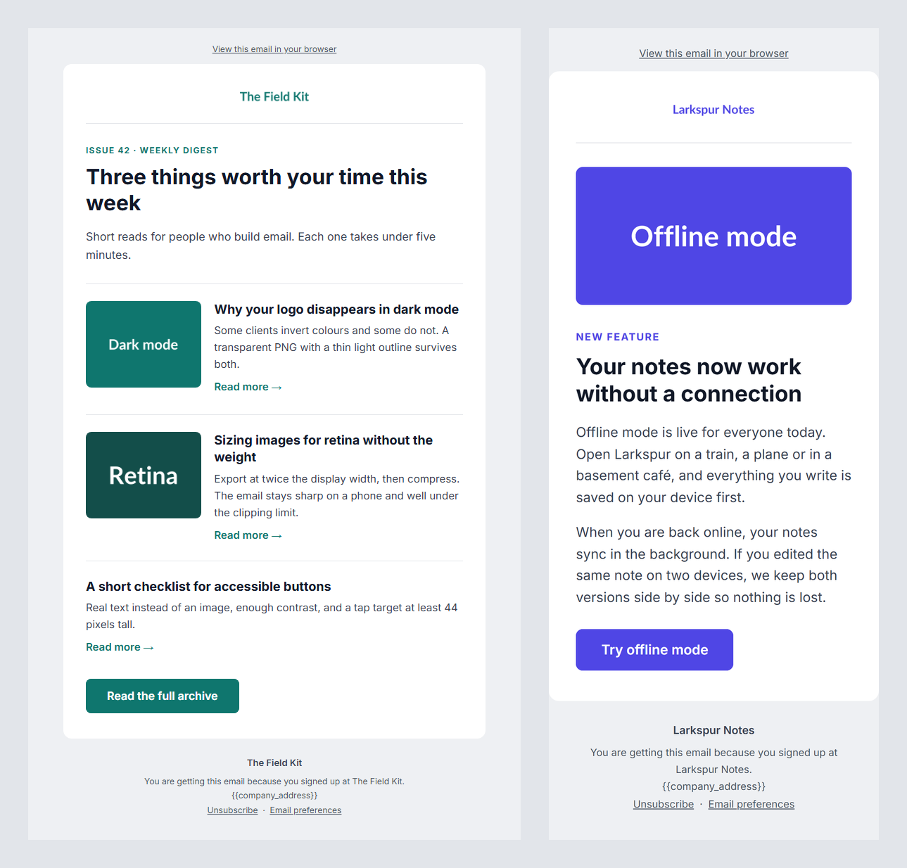

# brief-to-email

Give it a short JSON brief. It gives you an HTML email that renders properly in Gmail, Outlook and Apple Mail on desktop and on a phone, and it checks the result before you send it.



```bash
npm install
npm run build
```

```
weekly-digest
  PASS  Size under 102 KB (Gmail clips above this)   33.0 KB
  PASS  Every  has alt text                     3 images
  PASS  Preheader present                            "Dark mode email, faster image loading, and a ..."
  PASS  No MJML validation errors                    strict mode
  PASS  CTA link is https                            https://example.com/archive
  wrote output/weekly-digest.html
```

Open anything in `output/` in a browser to see it. The two sample emails are committed, so you can look before you install.

## Why I built it

A model can write good email copy in seconds. Getting that copy into an email that actually displays well is the hard part. Email clients are not browsers. Outlook on Windows renders with Word, Gmail strips `<style>` blocks in some views, and most clients ignore flexbox and grid. HTML that looks fine in a browser often breaks in a real inbox.

So I keep the two jobs apart. The content is plain data (the brief). The layout is a template written in [MJML](https://mjml.io), which compiles to the nested tables and inline styles that email clients expect. Then a set of checks catches the problems that would get past a quick look.

## How it works

```
briefs/*.json  ->  validate  ->  template (MJML)  ->  compile (strict)  ->  checks  ->  output/*.html
```

1. Read every file in `briefs/`.
2. Validate the brief. A brief with a missing field is skipped with a clear message, and the other briefs still build.
3. Fill the template named in the brief, then compile it with `validationLevel: "strict"`, so bad MJML stops the build instead of producing broken HTML.
4. Run the checks and print PASS or FAIL for each one.
5. Write `output/<brief-name>.html`.

The command exits with code 1 if any brief was skipped or any check failed, so CI or a send script can stop a bad email from going out.

## The brief

```json
{
  "template": "announcement",
  "brand": { "name": "Larkspur Notes", "primaryColor": "#4F46E5", "logoUrl": "https://..." },
  "subject": "Offline mode is here",
  "preheader": "Write on a plane, sync when you land.",
  "eyebrow": "New feature",
  "headline": "Your notes now work without a connection",
  "body": "First paragraph.\n\nA blank line starts a second one.",
  "cta": { "text": "Try offline mode", "url": "https://example.com/offline" },
  "items": [ { "title": "...", "text": "...", "url": "https://...", "image": "https://..." } ]
}
```

| Field | Required | Notes |
|---|---|---|
| `template` | yes | `announcement` or `newsletter` |
| `brand.name`, `brand.logoUrl` | yes | the logo is shown centred at 160px wide; give it a 2x image |
| `brand.primaryColor` | yes | 6-digit hex. Used for the button, links and labels. Button text switches to white or black, whichever has more contrast |
| `subject`, `preheader` | yes | the preheader is the grey preview line next to the subject in the inbox |
| `headline`, `body` | yes | all text is HTML-escaped |
| `cta.text`, `cta.url` | yes | the one button in the email |
| `items` | newsletter only | each needs `title`, `text`, `url`. `image` is optional (`imageAlt` defaults to the title) |
| `eyebrow`, `image` | no | a small label above the headline, and the announcement hero image (`{ "url", "alt" }`) |

The sample logos and images come from [placehold.co](https://placehold.co), as PNG because Gmail and Outlook do not show SVG.

## The templates

Both are mobile-first and 600px wide: logo header, headline, body, one button, and a footer with the unsubscribe and preferences links.

- **announcement**: one hero image, one message, one button. For a launch or a single update.
- **newsletter**: an intro and a list of items. On desktop an item's image sits next to its text, and on a phone they stack and the image goes full width.

The button is an `mj-button`, which compiles to a table cell with a background colour. It stays a button in Outlook and in clients that strip CSS.

Footer links use merge tags (`{{unsubscribe_url}}`, `{{preferences_url}}`, `{{view_in_browser_url}}`, `{{company_address}}`). Your sending platform fills these in.

## The checks

| Check | Why |
|---|---|
| Size under 102 KB | Gmail cuts off anything bigger with "[Message clipped]", and the unsubscribe link sits at the bottom |
| Every `` has alt text | Many clients block images by default, and screen readers read the alt text |
| Preheader present | Without it the inbox preview shows the first text it finds, often "View in browser" |
| No MJML validation errors | Strict mode. Invalid markup compiles to HTML that breaks in some clients |
| CTA link is https | Plain http links get flagged by spam filters and browsers |

## Add your own

Copy a file in `briefs/`, change the text and colours, and run `npm run build`. To add a layout, write a function in `templates/` that takes the brief and returns MJML (use `shell()` from `announcement.mjml.js` to keep the same frame), then add it to `TEMPLATES` in `build.js`.

## Next steps

- **Draft the brief from a prompt.** An LLM step that turns "announce offline mode to existing users, friendly tone" into a brief. The brief format already acts as the contract, so the model only writes content and never touches HTML.
- **Figma or screenshot input.** Read brand colours, logo and layout from a design file or a screenshot of a past campaign, and fill in `brand` from that.
- **Render testing across clients.** Send each output through Litmus or Email on Acid (or a local Outlook and Gmail check) and compare screenshots, because passing checks is not the same as looking right everywhere.
- **Dark mode.** Add `prefers-color-scheme` styles and a check that the logo still shows on a dark background.

## Limits

- The checks read the HTML. They do not render it in real clients.
- The size check measures the HTML only. Images load separately and are not counted.
- No tests yet. `npm run build` on the two sample briefs is the smoke test.

MIT licence.
